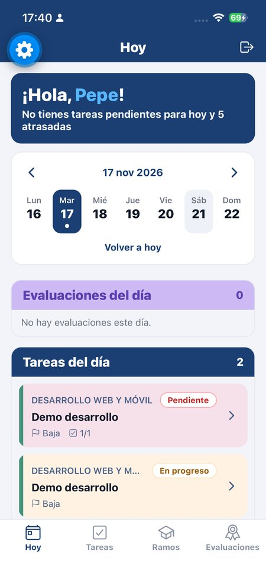
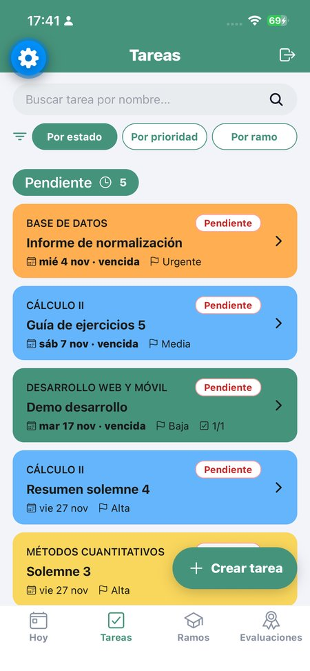
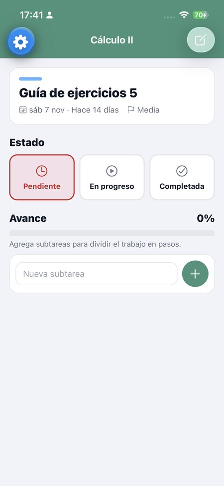
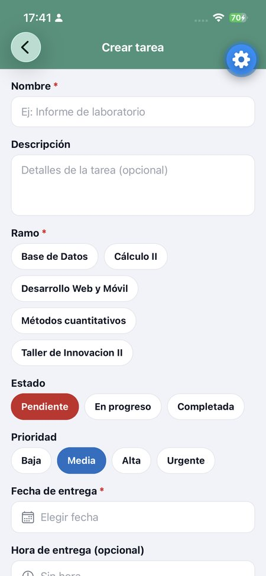
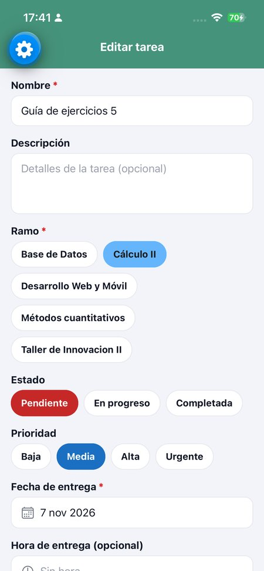
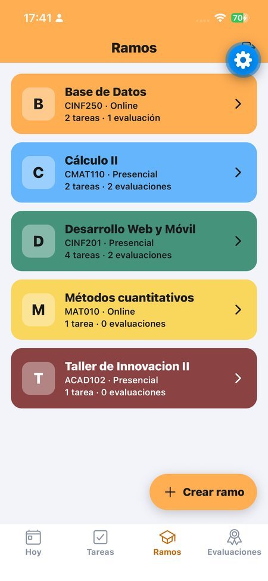
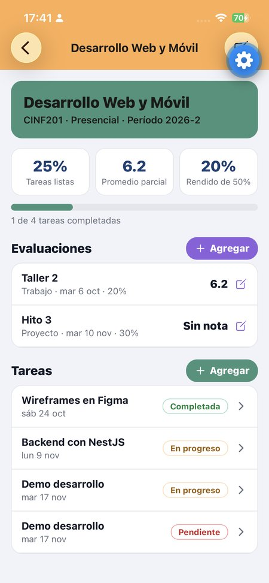
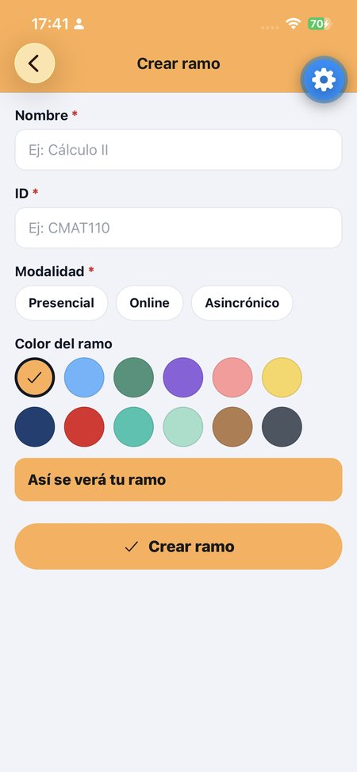
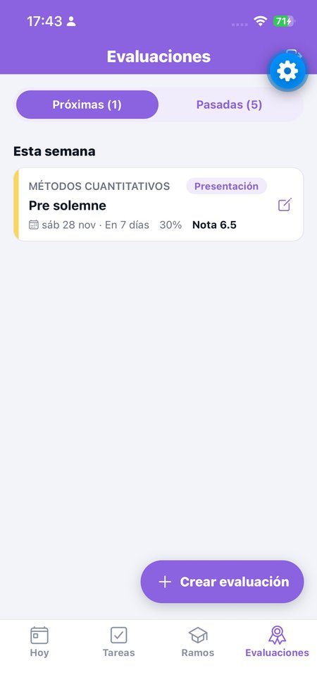
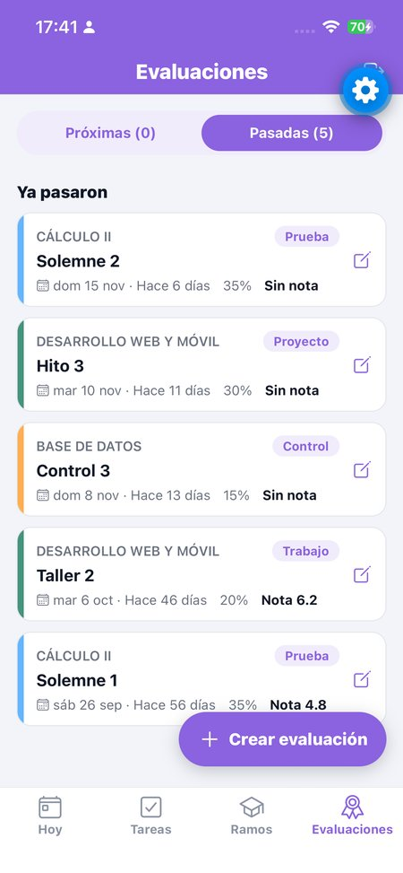

# Syllab móvil (Hito 4)

Aplicación móvil en **React Native con Expo** para la agenda académica personal (caso 3.2). Es un segundo cliente del sistema: usa **la misma API REST del Hito 3** y los mismos datos (PostgreSQL y MongoDB). No tiene backend ni base de datos propios.

## Flujos implementados

| Flujo obligatorio (caso 3.2) | Pantalla |
|---|---|
| Consultar asignaturas, tareas y evaluaciones próximas | **Ramos** (lista y detalle con avance), **Tareas**, **Evaluaciones** (próximas agrupadas por semana) |
| Visualizar la agenda y los estados de las actividades | **Hoy**: tira de la semana, bloques de vencidas, evaluaciones y tareas del día con su estado |
| Actualizar el estado o avance de las tareas | **Detalle de tarea**: botones Pendiente / En progreso / Completada (cambio rápido), subtareas con casilla y agregar subtareas |

Además se mantienen las funciones principales de la web del Hito 3:

| Función | Dónde |
|---|---|
| Crear, editar y eliminar **tareas** (nombre, descripción, ramo, estado, prioridad, fecha y hora) | Botón «Crear tarea» en Tareas, lápiz en el detalle, «Agregar» en el detalle del ramo |
| Buscar tareas y filtrarlas **por estado, por prioridad o por ramo** (como el botón Filtrar de la web) | Pestaña Tareas |
| Crear, editar y eliminar **ramos** (nombre, ID, modalidad y color con vista previa) | Botón «Crear ramo» en Ramos y lápiz en el detalle del ramo |
| Crear, editar (poner la nota) y eliminar **evaluaciones** | Botón «Crear evaluación», tocar una evaluación, «Agregar» en el detalle del ramo |
| Login con el mismo usuario de la web | Pantalla de inicio |

Los colores son los de la web: Hoy en azul, Tareas en verde, Ramos en naranjo y Evaluaciones en morado; las tarjetas usan los colores de estado del inicio de la web y el color de cada ramo con su texto legible (misma fórmula de contraste).

## Capturas

Capturas tomadas en un iPhone con Expo Go, con el usuario de prueba Pepe (el botón azul con engranaje es el menú de desarrollo de Expo Go, no es parte de la app).

| Hoy (agenda) | Tareas (filtro por estado) | Detalle de tarea (cambio rápido de estado) |
|:---:|:---:|:---:|
|  |  |  |
| Tira de la semana y bloques del día con el estado de cada tarea | Buscador, filtros por estado / prioridad / ramo y botón Crear tarea | Botones Pendiente / En progreso / Completada, avance y subtareas |

| Crear tarea | Editar tarea | Ramos |
|:---:|:---:|:---:|
|  |  |  |
| Mismos campos que la web; obligatorios con * | Campos rellenados con la tarea guardada | Cada ramo con su color y el texto legible encima |

| Detalle de ramo | Crear ramo | Evaluaciones |
|:---:|:---:|:---:|
|  |  |  |
| Avance, promedio parcial, evaluaciones y tareas con «Agregar» | Paleta de colores con vista previa | Próximas evaluaciones con días que faltan y nota |

| Evaluaciones pasadas |
|:---:|
|  |
| Al tocar una se edita (por ejemplo, para poner la nota) |

### Estados de interfaz

- **Carga:** indicador con texto en cada pantalla y en cada botón mientras se guarda.
- **Error:** mensaje de la API y botón «Reintentar»; si no hay conexión se avisa que el celular y el PC deben estar en la misma red.
- **Vacío:** mensajes como «Día libre» o «Sin tareas».
- **Confirmación:** aviso verde al guardar («Estado actualizado a …», «Subtarea completada»), aviso rojo si la API rechaza la operación.

### Validaciones

- Login: usuario y contraseña obligatorios antes de llamar a la API; credenciales incorrectas → mensaje de la API (401).
- Subtarea: el nombre no puede estar vacío (máx. 80 caracteres).
- Formularios: campos obligatorios marcados con *, errores bajo cada campo; ponderación entera de 1 a 100 (avisa cuánto usa ya el ramo) y nota de 1.0 a 7.0; antes de eliminar se pide confirmación.
- Reglas del backend que la app muestra: ramo repetido en el período (409), evaluaciones de un ramo sobre 100% o fuera del período (400).
- Regla de negocio del backend: **no se puede completar una tarea con subtareas pendientes** → la API responde 409 y la app muestra el motivo.

## Requisitos

- Node.js 20 o superior.
- App **Expo Go** en el celular (última versión, SDK 58).
- El backend del Hito 3 corriendo (ver README principal) en un PC de la **misma red Wi-Fi** que el celular.

## Configurar la dirección de la API

En el celular `localhost` es el propio celular, por eso se usa la **IP del PC** donde corre el backend.

1. Ver la IP del PC: en Windows `ipconfig` (Adaptador Wi-Fi → Dirección IPv4), en Mac/Linux `ifconfig`.
2. Copiar el archivo de ejemplo y poner esa IP:

   ```bash
   cp .env.example .env
   ```

   ```
   EXPO_PUBLIC_API_URL=http://192.168.1.20:3000/api
   ```

3. Comprobar desde el navegador del celular que responde: `http://IP-DEL-PC:3000/api/salud` debe mostrar `"postgres":"ok","mongodb":"ok"`.

Si no responde: el celular y el PC deben estar en la misma red (algunas redes de universidades aíslan los dispositivos; en ese caso usar el hotspot del celular) y el firewall del PC debe permitir Node.js en el puerto 3000.

## Ejecutar

```bash
cd mobile
npm install
npx expo start --lan
```

En **iPhone**, Expo Go pide tener iniciada la misma cuenta de Expo en el celular y en el PC (`npx expo login`).

Escanear el código QR con Expo Go (Android) o con la cámara (iOS). Usuario de prueba: **Pepe / pepe12345**.

## Endpoints que usa la app

| Método | Ruta | Dónde |
|---|---|---|
| POST | `/api/auth/login` | Login |
| GET | `/api/tareas` | Hoy, Tareas |
| GET | `/api/tareas/:id` | Detalle de tarea |
| POST | `/api/tareas` | Crear tarea |
| PATCH | `/api/tareas/:id` | Detalle de tarea: cambiar estado (`{ estado }`) y editar tarea |
| DELETE | `/api/tareas/:id` | Eliminar tarea |
| POST | `/api/tareas/:id/subtareas` | Detalle de tarea: agregar subtarea |
| PATCH | `/api/subtareas/:id` (`{ completada }`) | Detalle de tarea: marcar avance |
| GET | `/api/evaluaciones` | Hoy, Evaluaciones |
| POST / PATCH / DELETE | `/api/evaluaciones`, `/api/evaluaciones/:id` | Crear, editar y eliminar evaluación |
| GET | `/api/asignaturas` | Ramos |
| GET | `/api/asignaturas/:id` | Detalle de ramo (avance, evaluaciones y tareas) |
| POST / PATCH / DELETE | `/api/asignaturas`, `/api/asignaturas/:id` | Crear, editar y eliminar ramo |
| GET / POST | `/api/periodos` | Al crear un ramo se usa el período en curso (como la web) |

Todas las rutas (menos el login) mandan `Authorization: Bearer <token>`. Si el token vence (401), la app vuelve al login.

## Estructura

```
mobile/
├── .env.example          dirección de la API
├── src/app/              pantallas (Expo Router: cada archivo es una ruta)
│   ├── _layout.tsx       sesión y navegación (sin sesión solo se ve el login)
│   ├── login.tsx
│   ├── (tabs)/           pestañas: index (Hoy), tareas, ramos, evaluaciones
│   ├── tarea/[id].tsx    detalle de tarea (actualizar estado y avance)
│   ├── tarea/formulario.tsx       crear / editar tarea
│   ├── ramo/[id].tsx     detalle de ramo
│   ├── ramo/formulario.tsx        crear / editar ramo
│   └── evaluacion/formulario.tsx  crear / editar evaluación
├── src/components/       estados (carga, error, vacío), avisos y tarjetas
├── capturas/             imágenes de este README
└── src/services/         api.ts (cliente HTTP), sesion.tsx, agenda.ts (un servicio por recurso), fechas y colores
```

## Demostración sugerida

1. Abrir la app en Expo Go e iniciar sesión con Pepe.
2. Recorrer Hoy, Tareas, Ramos y Evaluaciones (datos reales de la API).
3. En **Tareas**, abrir «Guía de ejercicios 5» y cambiarla a **En progreso** → aviso verde.
4. Recargar la web (pantalla Tareas) y ver que la tarea pasó a «En progreso».
5. **Error:** abrir «Backend con NestJS» y tocar **Completada** → la API responde 409 («tiene 1 subtarea(s) pendiente(s)») y la app lo muestra en rojo. Marcar la subtarea pendiente y volver a completar → ahora sí se guarda.

## Uso de IA

Se usó Claude Code como apoyo para generar la estructura inicial de la app, los servicios HTTP y las pantallas a partir de los endpoints existentes del Hito 3. El equipo revisó y probó cada flujo en Expo Go contra la API real, verificó en la web que los cambios hechos desde el celular se guardaran, y ajustó textos, validaciones y el diseño de las pantallas.
